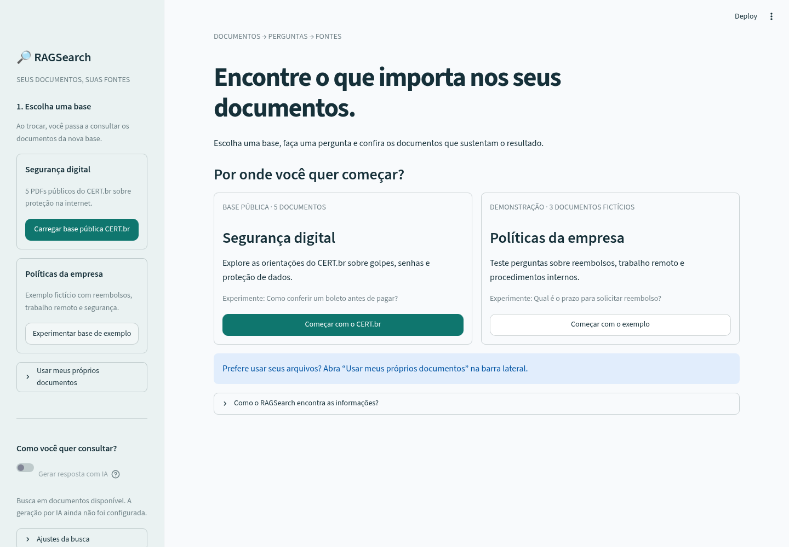
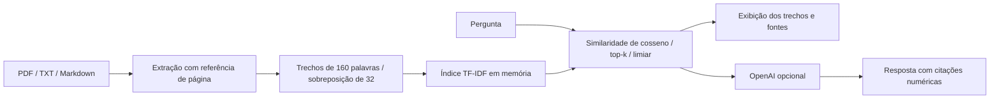

# RAGSearch 🔎

Um projeto de portfólio para explorar **Retrieval-Augmented Generation (RAG)**
com perguntas sobre PDFs e documentos em português. Envie arquivos, faça uma
pergunta e inspecione os trechos usados como contexto.

O modo de demonstração funciona localmente, sem chave de API. Ele apresenta
**resultados de busca**, sem simular uma resposta de IA. Com uma chave da OpenAI,
o mesmo contexto alimenta uma resposta gerada com referências numeradas.



A interface separa a base pública de segurança digital dos documentos fictícios
da empresa. Depois da escolha, o painel **Base ativa** identifica os documentos
consultados. As sugestões e o exemplo do campo de pergunta acompanham essa escolha.
Clicar em uma sugestão preenche o campo; a consulta começa ao clicar em
**Consultar documentos**. Se não houver resultados, a tela sugere uma reformulação
ou uma troca de base. Os controles de relevância ficam em **Ajustes da busca**.

## Executar

Requisitos: Python 3.12 e [uv](https://docs.astral.sh/uv/getting-started/installation/).
Na raiz do repositório:

```bash
uv sync --locked
uv run streamlit run app.py
```

No Windows, se o terminal não reconhecer `uv`, instale com
`winget install --id astral-sh.uv --exact` e reabra o terminal (ou o VS Code).
Execute os comandos na pasta que contém `pyproject.toml`, não na subpasta `ragsearch`.

Na interface, clique em **Experimentar base de exemplo** e pergunte:

- Qual é o prazo para solicitar reembolso?
- Como solicitar trabalho remoto?
- Por quanto tempo os backups são mantidos?

Também é possível criar sua própria base com PDFs que contenham texto, TXT e
Markdown em UTF-8. Cada nova indexação substitui a base anterior da sessão.
Os exemplos descrevem uma empresa fictícia e podem ser compartilhados livremente.

### Base pública: CERT.br

O repositório inclui **cinco PDFs oficiais do CERT.br**, com 102 páginas, sobre
backup, autenticação, golpes, redes sociais e proteção de dados. Consulte
[`corpora/certbr`](corpora/certbr/README.md) para fontes, licença CC BY-NC-ND 4.0
e limitações da extração. Na interface, clique em **Carregar base pública CERT.br**
e pergunte **Como conferir um boleto antes de pagar?**; o trecho relevante está na
página 13 do fascículo sobre golpes.

Para verificar a integridade local ou importar em um checkout sem os documentos:

```bash
uv run python -m ragsearch.corpus
```

O comando exige acesso a `cartilha.cert.br` e somente instala a base depois de
concluir os downloads e validar os PDFs. Registra fontes, licença indicada na
página oficial, data de obtenção e checksums. Nenhum arquivo existente é substituído.
O manifesto em `corpora/certbr/snapshot/manifest.json` registra a importação concluída.
A leitura dos PDFs reais e duas consultas com referência de página são verificadas
por `uv run pytest tests/test_public_corpus.py -q`; a avaliação sintética abaixo é
separada. Perguntas genéricas ainda podem recuperar capas ou trechos insuficientes.

### Geração opcional com IA

Crie um arquivo `.env` local a partir de `.env.example` e configure `RAG_API_KEY`.
O modelo padrão é `gpt-4.1-mini`; a variável `RAG_MODEL` permite alterá-lo.
Depois, ative **Gerar resposta com IA** na barra lateral.

A integração usa `https://api.openai.com/v1/chat/completions`. A chave precisa
de acesso ao modelo e de cota disponível; o provedor pode cobrar pelas chamadas.
Em ambientes de nuvem, forneça a chave nas configurações seguras, nunca no Git ou
no chat. Se a rede tiver uma lista de permissão, inclua `api.openai.com`.

**Privacidade:** a busca local não envia documentos para uma API. Ao ativar IA,
a pergunta, os trechos selecionados, os nomes dos arquivos e as páginas são enviados
à OpenAI. A aplicação não grava uploads em disco; eles permanecem na memória da
sessão e podem ser removidos com **Limpar base e resposta**. Isso não garante
apagamento imediato de memória ou remoção de dados tratados pelo provedor.

## Arquitetura



| Componente | Escolha e motivo |
| --- | --- |
| Interface | Streamlit: fluxo completo em Python e fácil demonstração |
| Extração | pypdf: texto de PDF com preservação da página |
| Recuperação | TF-IDF com unigramas, bigramas e cosseno: baseline lexical reproduzível |
| Contexto | Trechos sobrepostos e top-k configurável para inspecionar a recuperação |
| Geração | OpenAI opcional, com instruções para usar o contexto e citar fontes |
| Testes | pytest e AppTest: ingestão, recuperação, contrato da API e interface |

`ragsearch/retrieval.py` contém ingestão e busca; `generation.py`, a integração
com o modelo; `evaluate.py`, a avaliação local. `app.py` conecta esses componentes.

## Validar e avaliar

```bash
uv run pytest -q
uv run ruff check .
uv run ruff format --check .
uv run python -m ragsearch.evaluate
```

A avaliação usa cinco perguntas respondíveis e uma fora da base, declaradas em
`examples/evaluation.json`. O relatório mede a recuperação da fonte correta **com
a evidência esperada no primeiro trecho** e verifica a abstenção no caso sem
contexto. Esse conjunto é uma verificação pequena e sintética; ele não demonstra
qualidade em documentos reais nem mede a fidelidade da geração.

Os testes da API usam respostas simuladas para validar envio do contexto, citações
e tratamento de erros. Eles não validam acesso, custo ou qualidade de um modelo real.
A integração contínua executa os mesmos comandos em pushes e pull requests.

## Limitações e próximos experimentos

- **Baseline lexical:** TF-IDF pode perder sinônimos, paráfrases e relações semânticas.
  Comparar com embeddings multilíngues e busca híbrida é o próximo experimento.
- **Confiança:** similaridade não é probabilidade de acerto. O limiar precisa ser
  avaliado em perguntas e documentos representativos do domínio.
- **Citações:** a validação verifica números existentes, sem provar que as fontes
  sustentam cada afirmação. O modelo ainda pode alucinar ou seguir instruções de
  documentos maliciosos; as instruções de sistema são uma mitigação limitada.
- **Documentos:** PDFs digitalizados precisam de OCR. Tabelas, múltiplas colunas e
  imagens podem perder estrutura. Limites: 10 MB/arquivo, 200 páginas/PDF, 500 mil
  caracteres/documento, 20 arquivos e 2 milhões de caracteres/base.
- **Execução:** índice em memória, sem persistência, autenticação ou controle de acesso.
  A versão inicial serve para desenvolvimento e demonstração com dados não sensíveis.

Para evoluir o portfólio: ampliar o conjunto de avaliação com casos reais e difíceis,
comparar recall@k e custo/latência, experimentar embeddings e reranking, e avaliar
fidelidade e abstenção da geração separadamente da recuperação.
